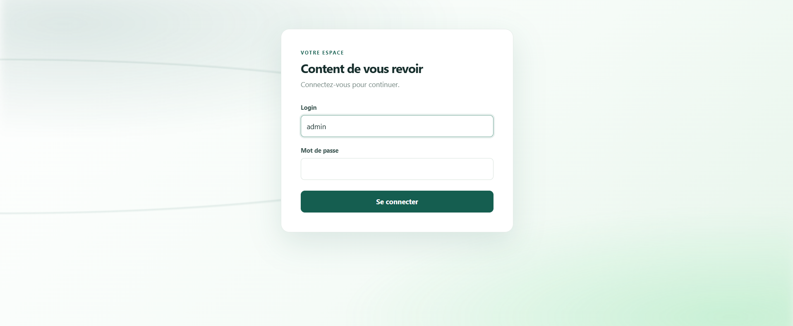
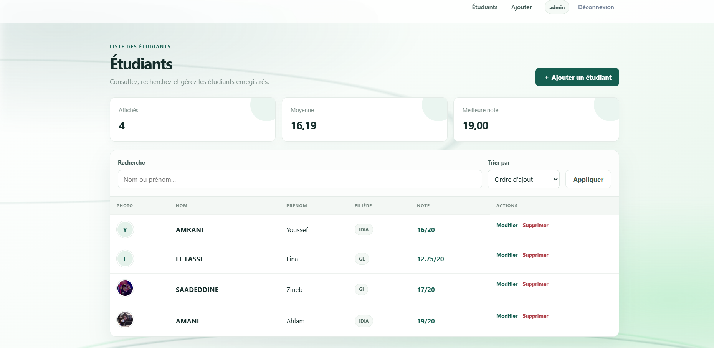
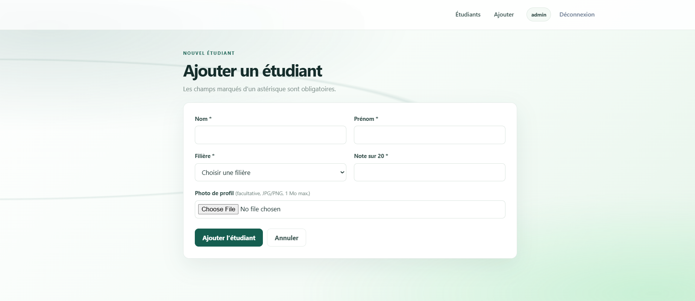
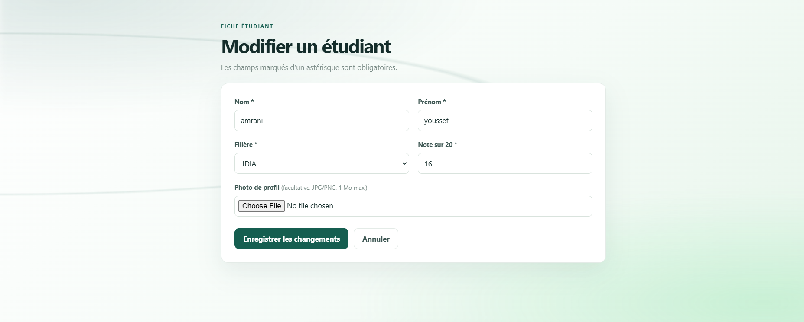

# TP PHP — Gestion des étudiants

Petite application PHP pour gérer une liste d’étudiants. Les données sont conservées dans un fichier texte, sans base de données.

## Aperçu de l’interface

### Connexion

### Liste des étudiants

### Ajout d’un étudiant

### Modification d’un étudiant

## Fonctionnalités

- Connexion avec session et mémorisation du dernier login pendant 7 jours.
- Consultation, recherche instantanée, tri et statistiques sur les notes.
- Ajout, modification et suppression d’étudiants.
- Téléversement facultatif d’une photo de profil.
- Validation des champs, notes de 0 à 20, filières autorisées et photos JPG/JPEG/PNG de 1 Mo maximum.

## Prérequis

- XAMPP avec Apache et PHP.
- Un navigateur Web.

## Lancer le projet avec XAMPP

1. Placez le dossier gestion_etudiants dans C:\xampp\htdocs.
2. Démarrez Apache depuis XAMPP Control Panel.
3. Ouvrez [http://localhost/gestion_etudiants/](http://localhost/gestion_etudiants/) dans le navigateur.
4. Connectez-vous avec le compte de démonstration ci-dessous.

| Login | Mot de passe |
| --- | --- |
| admin | admin123 |

## Stockage des étudiants

Les étudiants sont enregistrés dans data/etudiants.txt, une ligne par étudiant, avec six champs séparés par des points-virgules :

    id;nom;prenom;filiere;note;photo
    1;benali;sara;GI;14.5;etu_65a1.jpg

Le dernier champ contient le nom de la photo enregistrée dans uploads/. Il reste vide si aucune photo n’a été fournie.

## Structure du projet

    gestion_etudiants/
    ├── ajouter.php
    ├── data/
    │   └── etudiants.txt
    ├── footer.php
    ├── functions.php
    ├── header.php
    ├── index.php
    ├── liste.php
    ├── logout.php
    ├── script.js
    ├── style.css
    ├── supprimer.php
    └── uploads/

